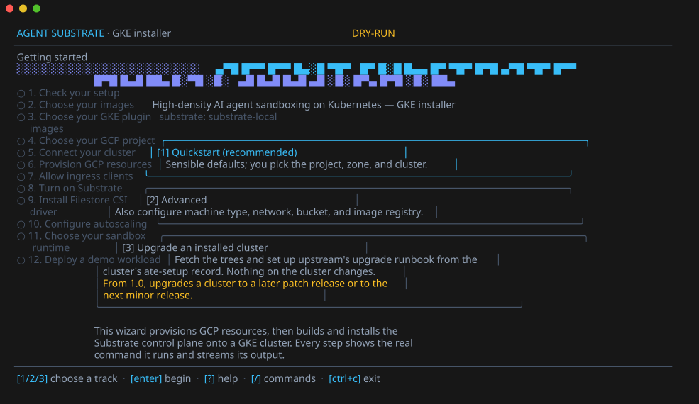
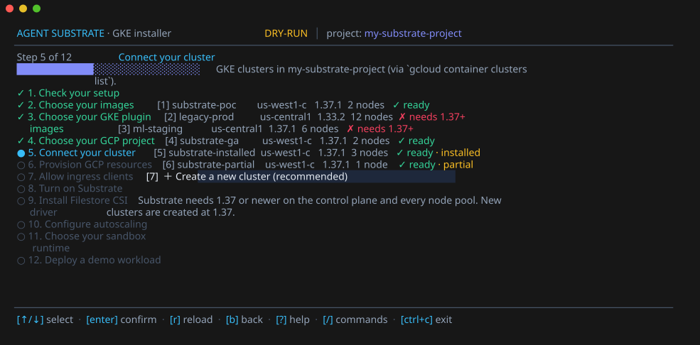
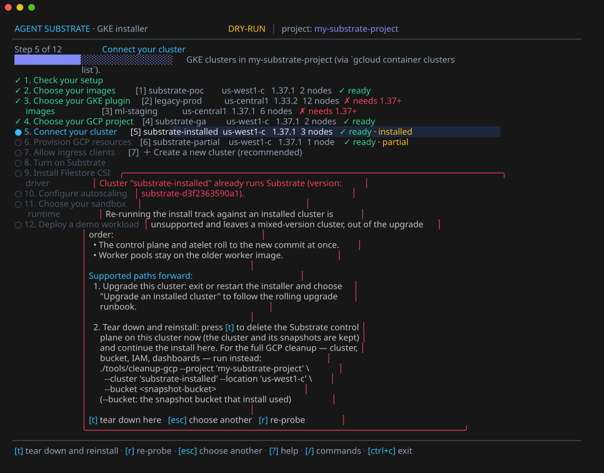
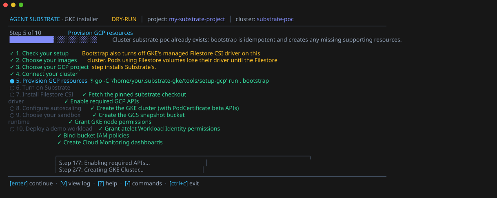
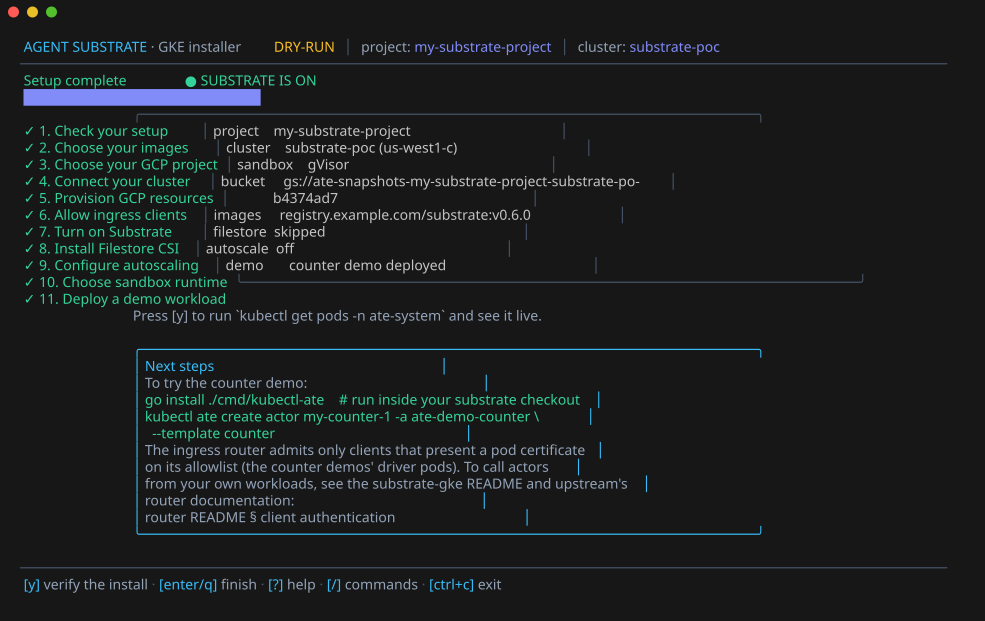

# substrate-gke

GKE packaging for [Agent Substrate](https://github.com/agent-substrate/substrate): an interactive terminal installer that provisions the required GCP resources and installs the Substrate control plane onto a GKE cluster.

> [!TIP]
> **New here?** Run `make dry-run` first — it walks the entire wizard without touching GCP, so you can see every prompt before committing to anything.

> [!WARNING]
> **This creates billable GCP resources.** A completed install provisions a GKE cluster, snapshot and micro-VM asset buckets, a snapshot transfer service account, IAM bindings, monitoring dashboards, and (for some source builds) an Artifact Registry repository. See [Tearing down](#tearing-down) to remove them — the wizard prints the exact cleanup command at the end of every install.



## Table of contents

- [Quickstart](#quickstart)
- [What the installer does](#what-the-installer-does)
- [Sandbox runtimes](#sandbox-runtimes)
- [Reaching actors through the ingress router](#reaching-actors-through-the-ingress-router)
- [Where the images come from](#where-the-images-come-from)
- [How Substrate itself is obtained](#how-substrate-itself-is-obtained)
- [Logs](#logs)
- [Upgrading an installed cluster](#upgrading-an-installed-cluster)
- [Tearing down](#tearing-down)
- [Development](#development)
- [Glossary](#glossary)

## Quickstart

**Prerequisites**

| Tool | Notes |
|---|---|
| `gcloud` | Authenticated, with [application-default credentials](https://cloud.google.com/docs/authentication/provide-credentials-adc) |
| Go | Version checked automatically — run `make substrate-pin-check` if unsure |
| `git` | — |
| `kubectl` | — |
| `gke-gcloud-auth-plugin` | `gcloud components install gke-gcloud-auth-plugin`, or the `google-cloud-cli-gke-gcloud-auth-plugin` package when gcloud came from apt or dnf |
| Docker with buildx | Only to build Substrate 0.2 or later from source, which builds its envoy-dataplane image with `docker buildx`. Docker also needs credentials for your registry: `gcloud auth configure-docker <registry-host>` |
| A GCP project with billing | Checked on the project step, which can also enable the GKE API for you |

The installer and `tools/setup-gcp` support Substrate [v0.6.0](https://github.com/agent-substrate/substrate/releases/tag/v0.6.0) and later only,
since [#92](https://github.com/ai-on-gke/substrate-gke/pull/92). Earlier releases fail every suspend and resume with `403` on the
IAM setup-gcp creates.

```bash
# One-line install and launch, ending with the counter demo (make run-demo):
curl -sSL https://raw.githubusercontent.com/ai-on-gke/substrate-gke/main/install.sh | bash -s -- --demo

# Or install for your own workloads, entering your clients' SPIFFE IDs (make run):
curl -sSL https://raw.githubusercontent.com/ai-on-gke/substrate-gke/main/install.sh | bash
```

Or from a local clone:

```bash
git clone https://github.com/ai-on-gke/substrate-gke.git
cd substrate-gke
gcloud auth application-default login
make run          # launch the interactive installer
make run-demo     # or: install and deploy the counter demo
```

**Useful variants**

| Command | What it does |
|---|---|
| `make run-demo` | Installs, then deploys the counter demo; the demo's driver pods are allowed on the ingress router on your behalf. The one-liner's `bash -s -- --demo` does the same |
| `make doctor` | Preflight checks only — no GCP calls |
| `make dry-run` | Walks the full wizard without touching GCP |

## What the installer does

A terminal wizard walks the steps below, running the real command it shows and streaming its output as it goes. `make run` walks steps 1–10; `make run-demo` adds step 11:

| # | Step | What happens |
|---|---|---|
| 1 | ✅ Check your setup | Probes `gcloud`, application-default credentials, Go, `kubectl`, `gke-gcloud-auth-plugin`, network reachability, `git`, and Docker with buildx and registry credentials — with copy-paste fixes for anything missing. Docker is only needed to build Substrate 0.2 or later from source, so those checks only warn here |
| 2 | 🖼️ Choose your images | Pre-built images from a registry you name, or build your own from a commit (the pin by default) — see [Where the images come from](#where-the-images-come-from) |
| 3 | 🏗️ Choose your GCP project | Validated live with `gcloud projects describe`, then checked for billing and the GKE API (`container.googleapis.com`), which the cluster step needs. A disabled GKE API can be enabled right there with `[e]`. Checks an explicit image registry when Docker is needed; the default regional registry is checked after cluster selection |
| 4 | 🔗 Connect your cluster | Lists your GKE clusters with install-state badges, or creates a new one (1.37 on the Rapid channel by default; advanced setup can pick another version and channel). Clusters already running Substrate are protected by a reinstall guard |
| 5 | ⚙️ Provision GCP resources | `setup-gcp bootstrap` — APIs, cluster (if new), per-cluster snapshot and micro-VM asset buckets, the snapshot transfer service account, IAM grants, monitoring dashboards, and an optional image repository. Idempotent |
| 6 | 🔐 Allow ingress clients | `make run` asks for the SPIFFE IDs of the clients the ingress router admits, prefilled from an exported `ATE_INGRESS_ALLOWED_SPIFFE_IDS`; what you enter replaces it. `make run-demo` sets the demo's driver pods instead. See [Reaching actors through the ingress router](#reaching-actors-through-the-ingress-router) |
| 7 | 🚀 Turn on Substrate | `ate-setup deploy ate-system` — installs CRDs, the API server, controller, atenet, and atelet, plus the bundled Kubernetes Secrets credential provider for egress credential injection. Export `ATE_CREDENTIAL_PROVIDER` before starting the installer to choose another, e.g. `{"enabled":false}` to turn injection off. The ingress router gets the client allowlist from step 6. Snapshots are stored under the root of the per-cluster snapshot bucket (`SNAPSHOT_LOCATION=gs://<bucket>/`) |
| 8 | 💾 Install Filestore CSI driver *(optional)* | Deploys the GCP Filestore CSI Driver configured for Substrate. If an existing cluster has GKE's managed Filestore driver on, this step turns it off first; skipping keeps it |
| 9 | 📈 Configure autoscaling *(optional)* | Node-pool autoscaling via `gcloud` |
| 10 | 📦 Choose your sandbox runtime *(optional)* | gVisor (installed with the control plane) or micro-VM — see [Sandbox runtimes](#sandbox-runtimes) |
| 11 | 🎬 Deploy a demo workload *(`make run-demo` only)* | Upstream counter demo (`counter` on gVisor, or `counter-microvm` on micro-VM), plus live verification and next steps |

> [!NOTE]
> Exiting and re-running is safe; every step is idempotent. A cluster that already runs Substrate is blocked from reinstall by the wizard's guard (preventing broken, mixed-version states); the wizard offers an in-place teardown or points at [Upgrading an installed cluster](#upgrading-an-installed-cluster) instead.

| Connect your cluster | Blocked: already installed |
| --- | --- |
|  |  |

| Provisioning | Complete |
| --- | --- |
|  |  |

<details>
<summary><strong>Why the steps are ordered this way</strong> (click to expand)</summary>

- **Setup check runs first** because the next step (images) is the first one to reach the network.
- **Images comes before the project step** because the answer decides what that step needs — a pre-built install pushes nothing, so it's never asked for a registry.
- **Connecting an existing cluster** probes it to confirm Substrate isn't already running there, guarding against mixed-version installs. It also badges whether the cluster meets Substrate's [cluster requirements](https://docs.cloud.google.com/kubernetes-engine/ai-ml/install-overview-substrate#cluster-requirements): GKE 1.37 or newer on the control plane and on every node pool. Node pools are checked because GKE lets them trail the control plane, and the kubelet is what serves pod certificates:

  | Release | Remedy |
  |---|---|
  | **1.37+, and every pool on 1.37+** | Nothing to fix. Bootstrap still turns the beta `PodCertificate` APIs on, which costs a control-plane update of about ten minutes but changes nothing Substrate depends on. |
  | **1.37+, with any pool below 1.37** | Not supported. The installer names the pools; upgrade each to 1.37 or newer (`gcloud container clusters upgrade CLUSTER --node-pool=POOL`). |
  | **control plane below 1.37** | Not supported. Upgrade the control plane first, then any pool below 1.37. |

  New clusters are created at 1.37 on the Rapid channel, so none of this applies to them. Advanced setup can pick a newer version or a different channel, like Regular; the installer rejects a version below 1.37, checks with GKE that the channel offers the version, and warns if it doesn't.
- **Filestore CSI driver** is optional and separate from autoscaling because configuring a Filestore VolumePool afterward is an additional step, not automatic.
- **Sandbox runtime comes right before the demo** so steps 1–9 finish setting up the cluster, storage, and node pools first, and on `make run-demo` step 11 immediately deploys the matching demo (`counter` or `counter-microvm`).
- **An existing cluster keeps its own network.** Provision's `setup-gcp bootstrap` warns when an existing cluster's network, subnetwork, or Dataplane V2 setting differs from what it's given, so the installer hands it the cluster's own values; the advanced track's network fields apply to new clusters only.

</details>

## Sandbox runtimes

Substrate runs each actor inside a sandbox, and step 9 chooses which kind.

| | gVisor | Micro-VM |
|---|---|---|
| Isolation | syscall interception in userspace | hardware virtualization (kata + cloud-hypervisor) |
| Installed by | the control-plane step, always | step 9, on request |
| Node requirement | none | **`/dev/kvm` on the node** |

**gVisor** is the default and needs nothing extra: `ate-setup` applies the
cluster-wide `gvisor-default` SandboxConfig as part of turning Substrate on.

**Micro-VM** is opt-in, because its sandbox binaries — cloud-hypervisor, virtiofsd, the
guest kernel, the guest rootfs and the base kata config — are fetched from GCS at boot
rather than baked into the worker image. Step 9 (`Choose your sandbox runtime`) reports
whether the cluster you selected has a KVM-capable node pool, and on choosing Micro-VM it
runs upstream's `hack/install-microvm-deps.sh --install` to assemble those five assets,
upload them under `kata-assets/` in `<bucket>-assets`, and apply a cluster-wide `SandboxConfig` named `microvm` that
points at them.

A WorkerPool then names it in `spec.sandboxClasses`:

```yaml
apiVersion: ate.dev/v1alpha1
kind: WorkerPool
metadata:
  name: my-microvm-pool
  labels:
    workload: my-microvm-pool
spec:
  sandboxClasses:
  - name: microvm
    configRef:
      name: microvm
  workerImage: <ateworker-microvm image>
```

An actor template runs on that pool by matching its labels in `workerSelector`, as
upstream's `demos/counter/counter-microvm.yaml.tmpl` and
`counter-microvm-template.yaml.tmpl` show.

> [!WARNING]
> **The installer does not yet provision KVM-capable node pools.** A micro-VM worker
> needs `/dev/kvm`; `atelet` advertises the `ate.dev/kvm` extended resource only on nodes
> that have the device, and the scheduler places micro-VM workers by that resource. On a
> cluster of ordinary nodes the install succeeds and micro-VM workers then stay `Pending`
> indefinitely.
>
> **Before installing**, ask GKE what your node pools are, since nested virtualization can
> only be set when a pool is created:
>
> ```bash
> gcloud container node-pools list --cluster CLUSTER --location LOCATION \
>   --format='table(name,config.machineType,config.advancedMachineFeatures.enableNestedVirtualization)'
> ```
>
> You need at least one pool with `enableNestedVirtualization: True`. Note that `e2`
> machine types cannot do nested virtualization at all — use `n1`, `n2`, `n2d`, or a
> bare-metal (`-metal`) machine type.
>
> **If you taint that pool** to reserve it, use `ate.dev/sandboxClass=microvm:NoSchedule`.
> That is the only toleration micro-VM worker pods carry, so a pool tainted with any other
> key repels them — and nothing above catches it: the pool has the hardware, `atelet`
> advertises `ate.dev/kvm`, the capacity check below reports the resource present, and the
> workers still sit `Pending`. To reserve a pool with a different key, add your own
> toleration to the WorkerPool's `spec.template.tolerations`, which is merged with the
> built-in one rather than replacing it.
>
> **After installing**, confirm `atelet` actually found the device:
>
> ```bash
> kubectl get nodes -o jsonpath='{range .items[*]}{.metadata.name}{"\t"}{.status.capacity.ate\.dev/kvm}{"\n"}{end}'
> ```
>
> This second check is only meaningful once Substrate is running: the resource is
> published by `atelet`, so on a cluster without it every node reports empty regardless of
> what hardware it has.
>
> Until node provisioning lands, bring your own KVM-capable pool — a node type with
> nested virtualization enabled, or bare metal, where KVM is native.

**Upgrading and teardown:** The upgrade flow (`--upgrade`) updates the control plane and
gVisor `SandboxConfig`, but does not re-stage `kata-assets/`; after upgrading a cluster
that uses micro-VM across a Substrate revision bump, target the cluster's kube context and
re-run `NO_DEV_ENV=1 ARCH=amd64 BUCKET_NAME=<bucket> hack/install-microvm-deps.sh --install`
so the bucket assets and `microvm` `SandboxConfig` digests stay in sync. Full teardown
(`ate-setup delete ate-system`) removes the `SandboxConfig` CRD and all `SandboxConfig`
resources automatically; if you want to drop micro-VM without tearing anything else down,
run `NO_DEV_ENV=1 hack/install-microvm-deps.sh --delete` against the cluster's kube
context (the staged assets in `kata-assets/` remain inert in the bucket).

## Reaching actors through the ingress router

Requests reach actors through `atenet-router` in `ate-system`. From Substrate v0.6.0
the default router is Envoy, which serves only TLS and admits only clients that
present a pod certificate whose SPIFFE ID is on its allowlist. Any listed client may
reach any actor. `ate-setup` will not deploy the Envoy router without an allowlist.

A client's ID comes from the namespace and service account its pod runs as:

```
spiffe://cluster.local/ns/<namespace>/sa/<service-account>
```

The trust domain `cluster.local` is fixed by Substrate's pod identity signer, so an ID
is known before the install. Clients are the workloads that send requests to actors,
usually your application's frontend or backend service. `kubectl ate` talks to the API
server, not the router, and needs no entry; neither do Substrate's own components.

The installer sets the allowlist at step 6, before it turns Substrate on. It is
exported as `ATE_INGRESS_ALLOWED_SPIFFE_IDS` for the run, replacing any value you
exported; the two lists are never merged.

- `make run` asks for your clients' IDs, comma-separated, and needs at least one.
  An exported `ATE_INGRESS_ALLOWED_SPIFFE_IDS` prefills the field:

  ```bash
  export ATE_INGRESS_ALLOWED_SPIFFE_IDS=spiffe://cluster.local/ns/shop/sa/frontend
  make run
  ```

- `make run-demo` uses the counter demos' driver pods,
  `spiffe://cluster.local/ns/ate-demo-counter/sa/default` and
  `spiffe://cluster.local/ns/ate-demo-counter-microvm/sa/default`, and says it
  exports them on your behalf, warning if that replaces a value you exported. Both
  are listed because the sandbox runtime, which decides the demo, is chosen after
  step 6. Any pod running as the default service account in those two namespaces can
  reach any actor.

To add a client after the install, redeploy the router with the full list. Each deploy
replaces the list rather than adding to it. From the substrate checkout, with the
cluster's ate-setup record as its configuration (see
[Upgrading an installed cluster](#upgrading-an-installed-cluster) for where it is):

```bash
go run ./cmd/ate-setup deploy atenet --config <record> \
  --credential-provider='{"name":"k8s.io"}' \
  --ingress-allowed-spiffe-ids=spiffe://cluster.local/ns/ate-demo-counter/sa/default,spiffe://cluster.local/ns/ate-demo-counter-microvm/sa/default,spiffe://cluster.local/ns/shop/sa/frontend
```

A client in the cluster mounts its certificate with a `podCertificate` projected
volume and the router's serving CA with a `clusterTrustBundle` one; upstream's
[router README](https://github.com/agent-substrate/substrate/blob/main/cmd/atenet/internal/router/README.md#ingress-client-authentication-and-authorization)
shows both.

For the demo's next steps, a Substrate tree whose counter demo has a driver pod ([agent-substrate/substrate#3178](https://github.com/agent-substrate/substrate/pull/3178))
reads its logs, `kubectl logs -n ate-demo-counter -l app=counter-driver -f`, which show
it calling the actor through the router. v0.6.0 has no driver, so the tour stops at
creating the actor.

The installer deploys the Envoy router only. `ate-setup` also offers agentgateway
through `ATE_ATENET_DATAPLANE`, but it has no support policy for GKE installs, so the
setup check (step 1) fails if `ATE_ATENET_DATAPLANE` is set to anything other than
`envoy`.

## Where the images come from

The images step chooses between two ways of getting the Substrate control-plane images. Both name a commit of [`agent-substrate/substrate`](https://github.com/agent-substrate/substrate) — `ate-setup` reads deployment manifests from that source tree either way. The repository is fixed; the commit is yours to choose.

| | **Pre-built images** | **Build from source** |
|---|---|---|
| **You provide** | Registry and tag (required), and the commit the images were built from | A revision: branch, tag, or full commit SHA |
| **Default value** | None for registry and tag; the commit defaults to the pin, upstream's [`v0.6.0`](https://github.com/agent-substrate/substrate/releases/tag/v0.6.0) tag | The pin, upstream's [`v0.6.0`](https://github.com/agent-substrate/substrate/releases/tag/v0.6.0) tag |
| **Needs a registry of yours?** | No — pull-only | Yes — built with [ko](https://ko.build) and pushed there |
| **Best for** | Images already published for the commit you install | No published images, or a branch or commit of your own |

Whichever you choose, the commit must be v0.6.0 or later (or a branch or
commit that includes it): `tools/setup-gcp` grants only what v0.6.0's
per-actor snapshot credentials need.

> [!NOTE]
> No registry of pre-built images is published at the moment. The GKE release
> registry (`us-docker.pkg.dev/gke-substrate-release/substrate`) is deprecated
> and has no images for v0.6.0; a replacement will be published in a different
> registry. Until then, a pre-built install needs images you or your team
> published, and building from source is the way to install the pin.

For source builds using the default registry, the installer creates `ate-images` at `<region>-docker.pkg.dev/<project>/ate-images`. The region follows the selected cluster. Advanced mode can override the repository name or use an existing image registry. Pre-built installs and custom image registries skip repository creation.

> [!IMPORTANT]
> **The commit has to be the one the images were built from.** `ate-setup` reads the manifests from it, so images built from another commit run behind manifests from a different Substrate. The commit field starts at the pin, which only fits images built from the pin.

<details>
<summary><strong>Other details worth knowing</strong> (click to expand)</summary>

- `ate-setup` pins every image to the digest its tag resolves to — nothing is built or pushed for a pre-built install.
- The tag doubles as the Substrate version that ate-setup records. The wizard checks at the prompt that it is a valid image tag. A tag carrying its digest (`v0.1.0-gke.1@sha256:…`) is fine — the version is the tag alone.
- For build-from-source, a checkout of your own (fork included) is installed with `--substrate-root` instead — see [How Substrate itself is obtained](#how-substrate-itself-is-obtained).
- Whatever you name is resolved to an exact commit *before* the install starts, and checked against the remote via a filtered shallow fetch — so a naming mismatch is caught at the prompt, not ten minutes into an install.

</details>

## How Substrate itself is obtained

`ate-setup` needs a Substrate source tree on disk at install time regardless of which images you chose — a pre-built install skips the *build*, not the *checkout*. That's why both paths in the images step ask for a revision.

The installer fetches it with a shallow `git` fetch pinned to an exact commit, into:

```
<user cache dir>/substrate-gke/substrate-<short commit>
```

One directory per commit, so two revisions never collide. The default pin is public, so no credentials are needed for it.

> [!CAUTION]
> This tree is scratch space for **one install**, not somewhere to work. **It is deleted once the install succeeds**, and re-running the installer fetches it again. If you want to develop against Substrate, use your own clone — see below.

```bash
# Point at your own checkout instead (handy for testing an unmerged change):
cd installer && go run . --substrate-root=/path/to/substrate
```

A checkout you supply this way is used as-is and never modified or deleted.

GCP provisioning is the exception: the `setup-gcp bootstrap` step runs this repository's [`tools/setup-gcp`](tools/setup-gcp/README.md), not a copy from the Substrate tree, whatever revision you chose. The tool moved here from upstream ([agent-substrate/substrate#2304](https://github.com/agent-substrate/substrate/issues/2304)). The installer finds it above its working directory or its executable; pass `--setup-gcp=/path/to/tools/setup-gcp` if you run the installer from somewhere else. To run setup-gcp and ate-setup yourself, without the installer, see [Setting up GKE by hand](docs/manual-gke-setup.md).

<details>
<summary><strong>Failure and retry behavior</strong> (click to expand)</summary>

- Nothing is deleted while an install could still be retried — a failed run leaves the tree in place, so retrying costs no re-download.
- The tree is staged under a temporary name and moved into place only once complete, so an interrupted fetch costs you the download and nothing else.

</details>

## Logs

Every command's full output is written to a timestamped log under `<user cache dir>/substrate-gke/logs/`. Press `v` in the wizard for a scrollable log viewer; failures show the extracted cause and the log path.

## Upgrading an installed cluster

> [!CAUTION]
> Do not re-run the install track against a cluster that already runs Substrate (the wizard blocks it). Run the installer and choose **Upgrade an installed cluster** instead.

From 1.0, upstream's [upgrade runbook](https://github.com/agent-substrate/substrate/blob/main/docs/upgrade.md) moves a cluster to a later patch release or to the next minor release.

The upgrade flow prepares the runbook and changes nothing on the cluster. It names the cluster, reads the version and commit its API server reports (`ateapi --version` prints both), takes the new version from the images step, and fetches the installed and new source trees into `<user cache dir>/substrate-gke/upgrades/`. Press enter and it does the runbook's "Before you start" for you: it links the two trees into `~/ate-upgrade`, copies the cluster's ate-setup record there as `old.yaml` and `new.yaml`, installs the installed release's `kubectl ate`, and creates the snapshot transfer service account new releases use. It refuses to replace an `~/ate-upgrade` left from an earlier upgrade. Then run the one line it prints, which moves your shell to the new tree and sets `NEW_RELEASE` (or `VERSION` for a build from source), and follow the runbook from step 1. **Nothing on the cluster changes until you do.**

ate-setup writes that record on every deploy, under `ATE_RECORD_DIR` or by default at `<user cache dir>/ate-setup/installs/gke_<project>_<location>_<cluster>.yaml`. On a machine without it, write one from the settings the cluster was installed with ([operator-install.md](https://github.com/agent-substrate/substrate/blob/main/docs/operator-install.md) lists them).

The flow refuses an upgrade the runbook does not support, including a move between pre-built images and a build from source. If the API server doesn't report its build, you'll be prompted for the installed commit and version.

## Tearing down

An install creates **billable resources**: the GKE cluster, the snapshot and micro-VM asset buckets, IAM bindings, monitoring dashboards, and any image repository provisioned for a source build.

```bash
./tools/cleanup-gcp --project <project> --cluster <cluster> --location <zone> --bucket <bucket>
# or:
make teardown PROJECT_ID=<project> CLUSTER_NAME=<cluster> CLUSTER_LOCATION=<zone> BUCKET_NAME=<bucket>
```

> [!TIP]
> The exit summary from your install prints this exact invocation pre-filled — copy it from there rather than retyping values.

The script asks for confirmation, then runs this repository's [`tools/setup-gcp/teardown.sh`](tools/setup-gcp/teardown.sh). It needs only `gcloud`. `cleanup-gcp` sets `NO_DEV_ENV=1`, so `teardown.sh` ignores any `.ate-dev-env.sh` in the working directory; run directly, `teardown.sh` sources that file. Already-deleted resources are skipped. Failed deletion steps are listed at the end, and the script exits non-zero.

This deletes the dashboards, the snapshot transfer service account and the project-level IAM bindings too, which every Substrate cluster in the project shares. If other Substrate clusters still use the project, add `--cluster-scoped` (or `CLUSTER_SCOPED=true` with `make teardown`): it deletes only this cluster, its buckets and the bindings on them.

Repositories are kept by default; the installer adds `--delete-repository` when it provisioned one, and `--repository` if the name is not `ate-images`. The region is derived from the cluster location. Replace `--delete-repository` with `--keep-repository` if the images are shared. With `make teardown`, use `DELETE_REPOSITORY=true` and, for a custom name, pass `ARTIFACT_REGISTRY_REPOSITORY=<name>` on the command line.

To remove **only** the Substrate control plane and keep the cluster:

```bash
ate-setup delete ate-system   # printed in the exit summary
```

APIs enabled by the install are left enabled — they cost nothing while unused.

## Development

```bash
make test         # unit tests for installer/ and tools/setup-gcp/, including a scripted dry-run walk of the wizard
make verify       # gofmt + go vet for both modules
make screenshots  # regenerate the README screenshots from the dry-run wizard
```

### Bumping the pinned commit

This changes what fresh installs get. Edit `Commit` in `installer/internal/snapshot/snapshot.go`, and update `MinGoVersion` next to it to match the `go` directive in that revision's `go.mod`.

```bash
make substrate-pin        # print the current pinned values
make substrate-pin-check  # verify MinGoVersion against upstream's go.mod — run after every bump
```

> [!WARNING]
> Skipping `make substrate-pin-check` after a bump lets the preflight doctor pass while the install fails mid-bootstrap.

`Commit` is a default, not a limit: the images step offers it as the revision to build from and as the commit pre-built images were built from, and accepts any other revision. There is no default image registry or tag to bump with it.

## Glossary

| Term | Meaning |
|---|---|
| `ate-setup` | CLI that installs/upgrades/deletes the Substrate control plane on a cluster |
| `atenet`, `atelet` | Substrate control-plane components installed alongside the API server and controller |
| `PodCertificate` APIs | The `certificates.k8s.io` APIs Substrate requires: `clustertrustbundles` and `podcertificaterequests`. GKE 1.37+ serves them as `v1`, which Substrate uses. |
| Pinned commit | The exact commit of `agent-substrate/substrate` this installer's manifests and default images are built from |
